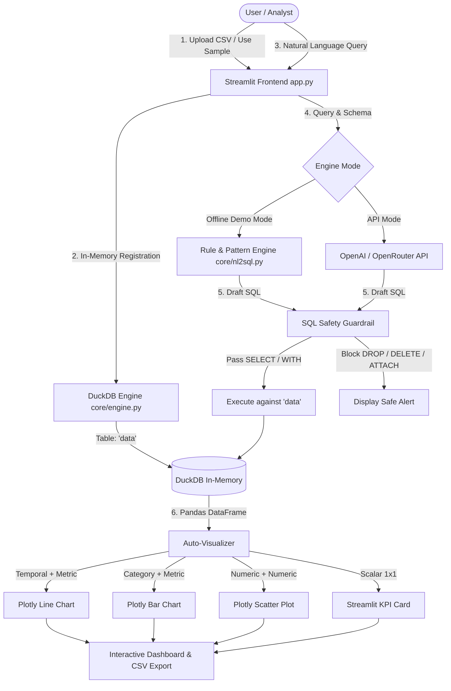

# ⚡ QueryLens DuckDB

> Instant, in-memory Natural Language to SQL analytics on any CSV powered by **DuckDB**, **Streamlit**, and **Plotly**.

[](https://streamlit.io/)
[](https://duckdb.org/)
[](https://plotly.com/)
[](LICENSE)

---

## 🎯 Problem Statement

Data analysts, product managers, and business operators often receive one-off CSV exports and need rapid answers to exploratory questions. However:
1. **Traditional BI tools** require heavy data pipelines, warehouse uploads, or credentials.
2. **Spreadsheet software** chokes on large datasets or complex multi-dimensional aggregations.
3. **Generic AI wrappers** frequently execute unvalidated queries or fail when no external LLM API key is provided.

**QueryLens DuckDB** solves this by providing a lightweight, production-ready, local-first analytics workbench:
- **Zero API Key Barrier**: Includes a reliable **Offline Demo Mode** capable of answering common analytical questions out of the box.
- **Extreme Speed**: Powered by **DuckDB in-memory**, executing analytical queries across millions of rows in milliseconds.
- **Strict Read-Only Guardrails**: Enforces that only safe `SELECT` / `WITH` statements are permitted, blocking any mutating operations (`DROP`, `DELETE`, `UPDATE`, `ALTER`, `ATTACH`).
- **Zero-Config Visualization**: Intelligently determines the shape of the result set to render interactive Plotly bar charts, line charts, scatter plots, or KPI cards automatically.

---

## 🏗️ Architecture



---

## 🚀 3-Command Quickstart

```bash
# 1. Clone repository
git clone https://github.com/your-username/querylens-duckdb.git
cd querylens-duckdb

# 2. Install dependencies
pip install -r requirements.txt

# 3. Launch the application
streamlit run app.py
```

The application will launch in your browser at `http://localhost:8501`.

---

## 📂 Repository Structure

```
querylens-duckdb/
├── app.py                 # Streamlit UI, visualizer & user interaction
├── core/
│   ├── __init__.py        # Package initialization
│   ├── engine.py          # In-memory DuckDB connection, schema inspection & SQL safety validator
│   ├── nl2sql.py          # Offline pattern translator & OpenAI/OpenRouter LLM translator
│   └── sample_data.py     # Clean 200-row synthetic e-commerce sales generator
├── tests/
│   └── test_engine.py     # Unit test suite verifying safety guardrails and SQL generation
├── requirements.txt       # Production dependencies
├── .gitignore             # Standard Python gitignore
└── README.md              # Project documentation and architecture
```

---

## 💡 Capabilities & Modes

### 1. Offline Demo Mode (Default, No Key Needed)
Works immediately without requiring an internet connection or an API token. The built-in rule engine parses natural questions such as:
- **Grouped Aggregates**: *"Total revenue by region"*, *"Average units sold per category"*
- **Top / Bottom Rankings**: *"Top 5 products by profit"*, *"Lowest 3 categories by revenue"*
- **Time Series / Trends**: *"Revenue trend over time"*, *"Sales by month"*
- **Counts & Summaries**: *"How many orders"*, *"Count of unique products"*

### 2. OpenAI / OpenRouter Mode
Enter your API key in the sidebar to unlock arbitrary natural language questions across complex multi-table joins, subqueries, and window functions using `gpt-4o-mini`, `gpt-4o`, or any OpenRouter model.

### 3. SQL Safety Guardrails
To prevent accidental data loss or injection attacks, every generated or manual query is sanitized:
- Strictly allows queries starting with `SELECT` or `WITH`.
- Forbids multi-statement execution (semicolons separating queries).
- Rejects mutating keywords: `DROP`, `DELETE`, `UPDATE`, `INSERT`, `ALTER`, `ATTACH`, `DETACH`, `CREATE`, `PRAGMA`, etc.

---

## 🧪 Running Tests

Run the test suite with standard Python:

```bash
python tests/test_engine.py
```

---

## 📜 License

MIT License. Free to use, modify, and distribute.
